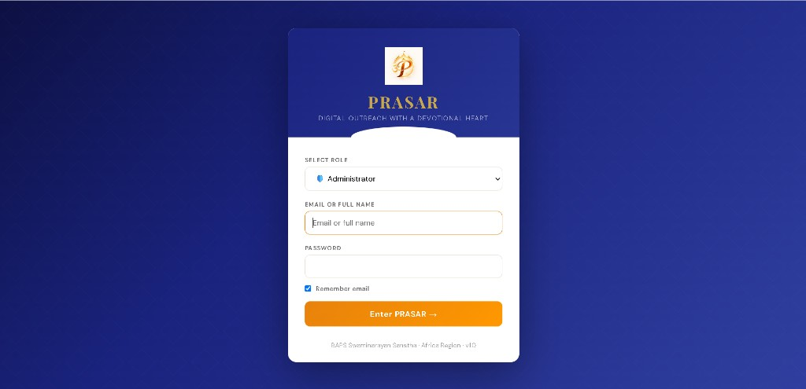
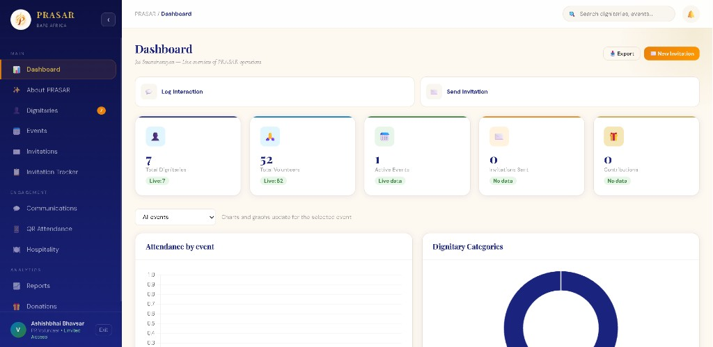
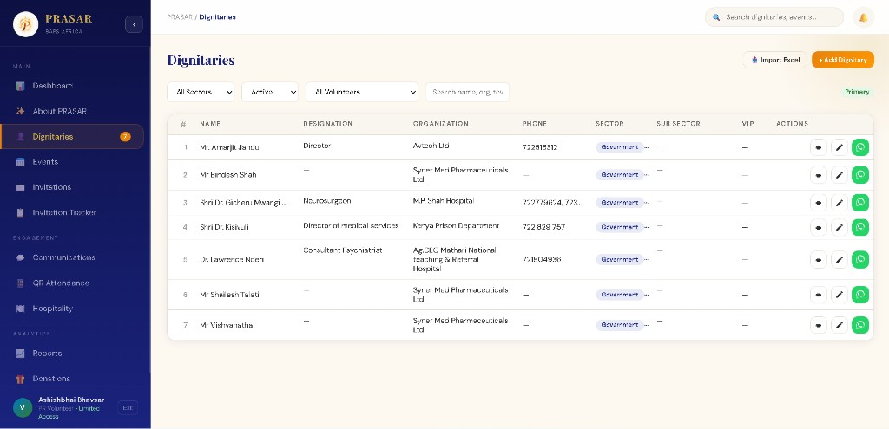
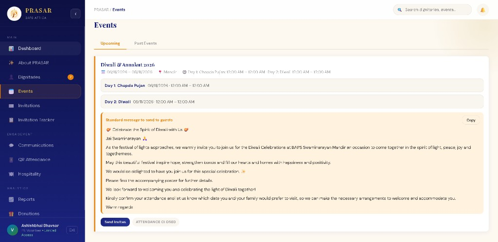
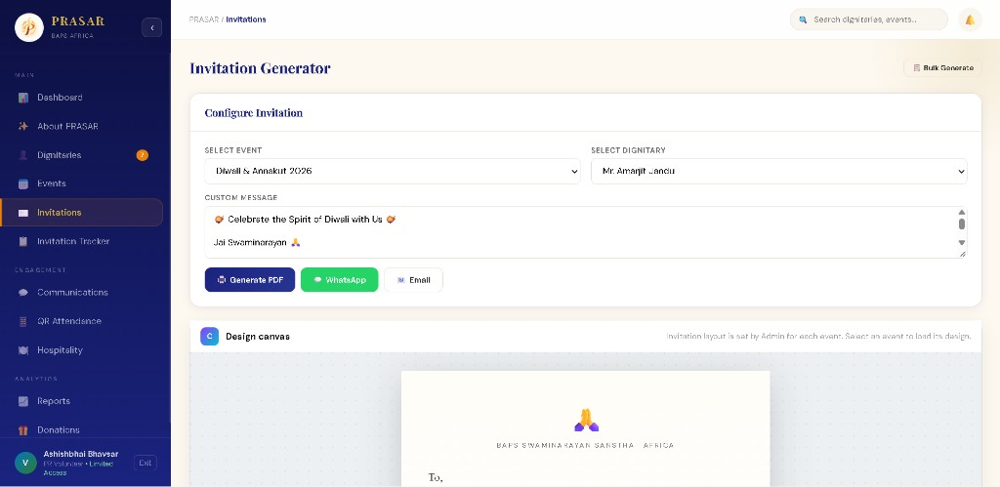
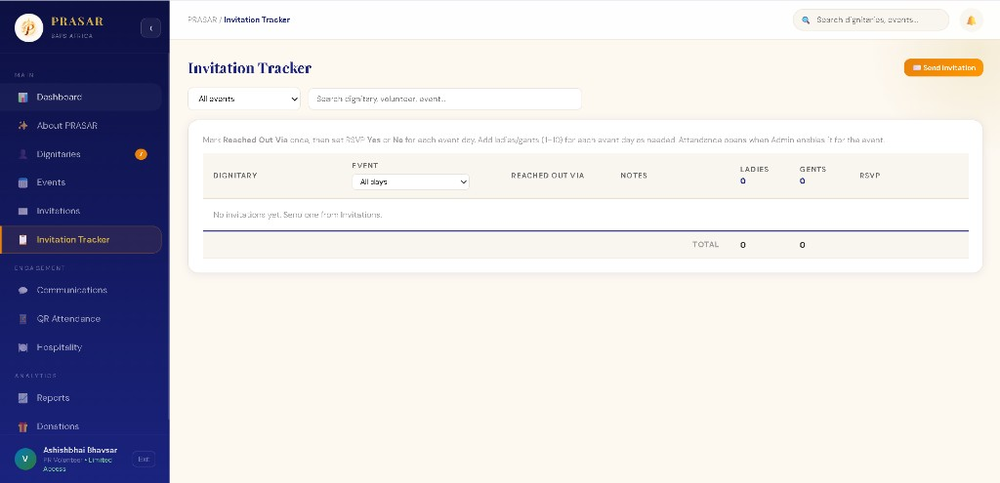
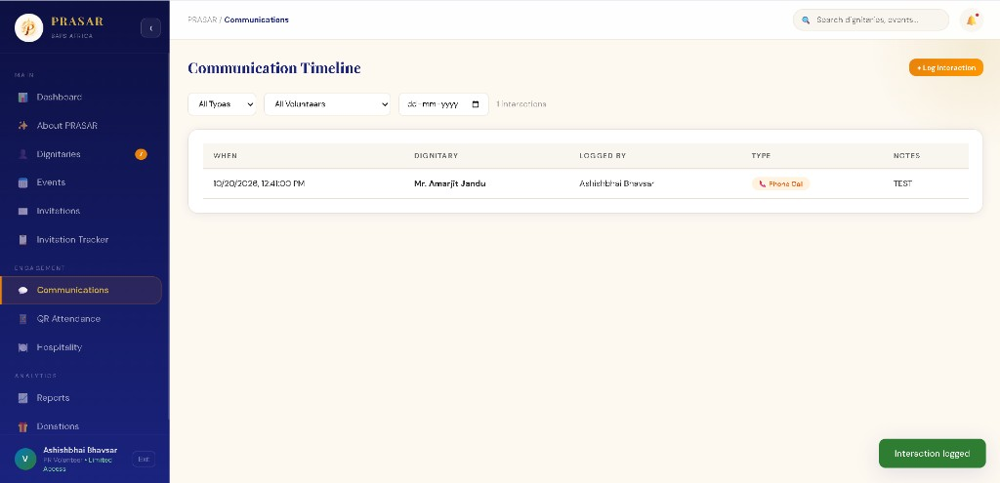
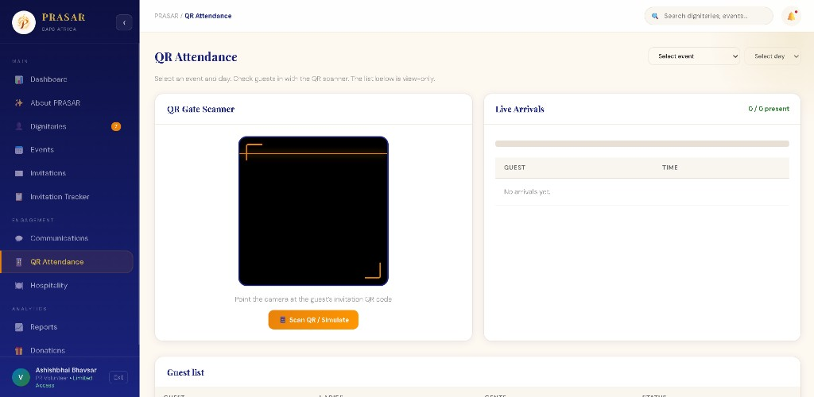

# PRASAR — PR Volunteer User Guide

This guide explains how **PR Volunteers** (Karyakars) use PRASAR for dignitary outreach: who you can see, how to invite guests, track responses, log calls, and check in attendees.

**App URL:** https://prasar.vercel.app  
**Your role in the app:** **PR Volunteer** (sidebar shows *Limited Access*).

---

## 1. What PRASAR does for you

PRASAR is the BAPS Africa digital tool for public-relations seva. As a volunteer you typically:

1. Work with **your assigned dignitaries** (guests).
2. Use **published events** created by administrators.
3. **Send invitations** (PDF, email, or WhatsApp when enabled).
4. **Track** outreach and RSVP in the Invitation Tracker.
5. **Log** phone calls and other contact in Communications.
6. **Scan QR codes** at the mandir when attendance is open for an event.

You do **not** manage other volunteers, approve guests, or change system-wide settings—admins handle that.

---

## 2. Signing in

1. Open the PRASAR link in your browser (Chrome or Edge recommended).
2. Under **Select role**, choose **PR Volunteer**.
3. Enter the **email** and **password** from your credentials sheet (use email, not only your name, if you were given one).
4. Optionally tick **Remember email** for next time.
5. Click **Enter PRASAR**.

If login fails, confirm role is **PR Volunteer**, check caps lock, and contact an administrator to reset your password.



---

## 3. Your sidebar and access

After login you see the dark blue sidebar. Available pages depend on what your **administrator enabled** in Master Edits. A typical volunteer menu includes:

| Section | Pages |
|---------|--------|
| **Main** | Dashboard, About PRASAR, Dignitaries, Events, Invitations, Invitation Tracker |
| **Engagement** | Communications, QR Attendance, Hospitality |
| **Analytics** | Reports, Donations |

Your name and **PR Volunteer • Limited Access** appear at the bottom. Use the exit control there to sign out.

**Important:** You only see **dignitaries assigned to you** (primary, secondary, or tertiary volunteer on their record). Counts on the dashboard and Dignitaries badge reflect *your* list, not the whole region.

---

## 4. Dashboard

The dashboard is your home screen after login.

- **Quick actions:** **Log Interaction** and **Send Invitation** jump to common tasks.
- **Stat cards:** Your dignitary count, regional volunteer count, active events, invitations sent, etc. (figures sync from the server when you log in).
- **Charts:** Use **All events** (or a specific event) to filter attendance and category charts when data exists.

Use the top search box to find dignitaries or events quickly.



---

## 5. Dignitaries — your guest list

Open **Dignitaries** from the sidebar.

### What you see

- A numbered list (**1, 2, 3…**) sorted **A–Z** by name.
- Columns: name, designation, organization, phone, sector, sub sector, VIP.
- Filters: sector, active/inactive, volunteer filter, and search (name, org, town, etc.).

### What you can do

- **View** (eye) — full profile: dietary, protocol notes, contact details.
- **Edit** — update details for guests you manage (changes may require admin approval if your center uses approvals).
- **WhatsApp** (green) — open chat when a mobile number is stored.
- **Add Dignitary** / **Import Excel** — if your admin allows; new guests may sit in **Pending** until an administrator approves them.

You cannot delete dignitaries unless your deployment grants admin tools; volunteers normally add/edit only.



---

## 6. Events — programs you invite guests to

Open **Events**. Tabs: **Upcoming** and **Past Events**.

- You only see **published** events (not admin drafts).
- Each card shows dates, venue, and per-day schedule (Day 1, Day 2, …).
- **Standard message to send to guests** is the default wording for invitations; admins set this. It may show as several paragraphs.
- **Send Invites** opens the Invitations page for that event.
- **Attendance closed / open** — only when an admin **enables attendance** can you use QR check-in for that event.



---

## 7. Invitations — generate and send

Open **Invitations** (or **Send Invites** from an event).

### Steps

1. **Select event** — e.g. *Diwali & Annakut 2026*.
2. **Select dignitary** — only **your** active, approved guests appear.
3. **Custom message** — leave blank to use the event standard message, or edit for this guest.
4. **Design canvas** — shows the invitation layout. **Admins design the layout per event**; you load it by selecting the event. You do not change the master template unless you are an admin.
5. Actions:
   - **Generate PDF** — download/print formal invitation.
   - **WhatsApp** — send when WhatsApp is configured on the server.
   - **Email** — sends via Postmark when configured; otherwise admin may use outbox mode on staging.

Use **Bulk Generate** when sending many PDFs at once (admin-heavy flows may vary).



---

## 8. Invitation Tracker — follow-up grid

Open **Invitation Tracker** after invitations exist.

For each dignitary / event you can record:

- **Reached out via** (phone, WhatsApp, email, in person, etc.).
- **Notes** from conversations.
- **Ladies / Gents** counts (per event day when applicable).
- **RSVP** yes/no per day.
- **Attendance** when the admin has enabled attendance for the event.

Filter by event or search. If the table is empty, create an invitation first from the **Invitations** page (**Send Invitation** on the dashboard also works).

Tip shown in the app: mark *Reached Out Via* once, then set RSVP for each day; add ladies/gents counts as needed.



---

## 9. Communications — log every touchpoint

Open **Communications** → **Communication Timeline**.

1. Click **+ Log Interaction**.
2. Choose **dignitary**, **type** (phone, WhatsApp, email, in-person, PDF sent, gift), date/time, and **notes**.
3. Save — the row appears with **Logged by** your name.

Filter by type, volunteer, or date. This creates a shared history so admins and other sevaks see outreach continuity (subject to visibility rules).



---

## 10. QR Attendance — at the venue

Open **QR Attendance** when guests arrive.

1. Select **event** and **day** (must match a published event with attendance **enabled** by admin).
2. Use **Scan QR / Simulate** — point the camera at the QR on the guest’s invitation PDF.
3. **Live arrivals** lists who checked in and when.
4. **Guest list** at the bottom is view-only for ladies/gents/status summary.

If attendance is closed on the event card, contact an administrator to enable it before the program.



---

## 11. Other pages (brief)

| Page | Volunteer use |
|------|----------------|
| **About PRASAR** | Mission and values — read-only. |
| **Hospitality** | Dietary and protocol planning for assigned guests. |
| **Reports** | Charts and exports for your activity where enabled. |
| **Donations** | Record donations linked to dignitaries when your team uses this module. |

Pages such as **Approvals**, **Master Edits**, **Settings**, and **User Management** are **admin-only** and do not appear on your menu.

---

## 12. Recommended weekly workflow

```
Monday–Wednesday     Review Dignitaries → update phones/emails
        ↓
        Send Invitations (PDF / WhatsApp / Email)
        ↓
        Update Invitation Tracker (reached out, RSVP)
        ↓
        Log Communications for every call/message
        ↓
Event day              QR Attendance check-in
        ↓
After event            Finalize tracker & notes for handover to admin
```

---

## 13. Tips and troubleshooting

| Situation | What to do |
|-----------|------------|
| Empty dignitary list | Confirm admin assigned you on guest records (primary/secondary/tertiary volunteer name must match your full name). |
| Cannot see an event | Event must be **Published**; drafts are admin-only. |
| No invitation template | Select the event first; admin must save a layout for that event. |
| WhatsApp/email button fails | Server may not have Postmark/WhatsApp keys—use **Generate PDF** and send manually. |
| QR scan not working | Allow camera permission; pick correct event/day; ask admin to enable attendance. |
| Guest not in dropdown | Guest must be **Active**, **Approved**, and assigned to you. |

---

## 14. Getting help

- **Password / access:** Regional PR administrator (admin `@prasar.admin` accounts).
- **Technical issues:** Contact your regional PR tech coordinator.

---

*PRASAR · BAPS Swaminarayan Sanstha · Africa Region · PR Volunteer Guide*
